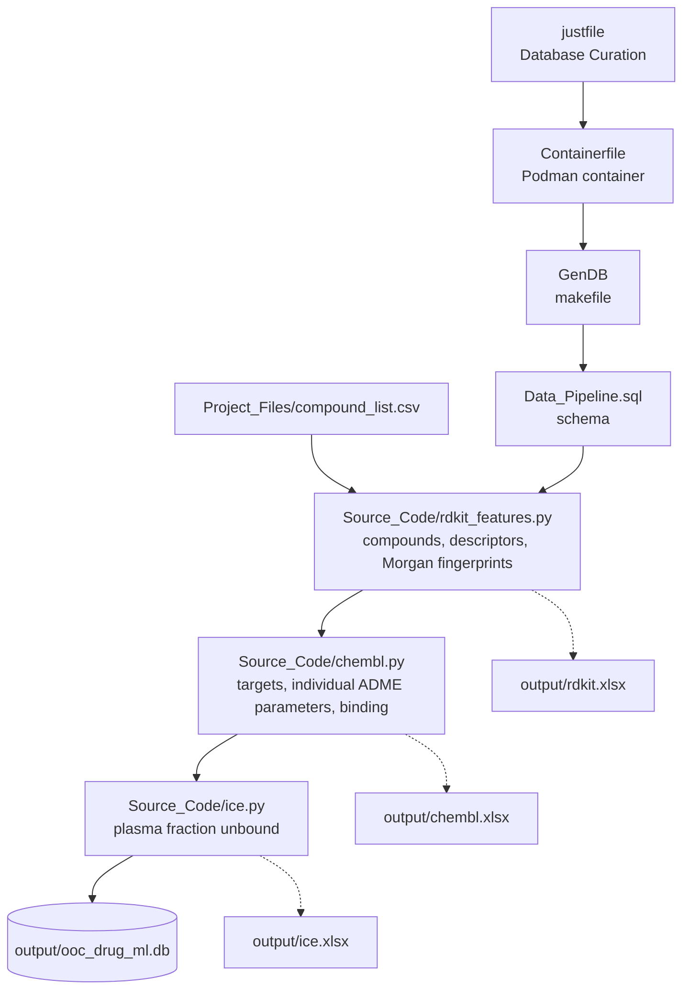

# Bioanalysis-OoC-rIVIVE-ML

Database Curation: builds one SQLite database and one spreadsheet per data source for the compound list in
`Project_Files/compound_list.csv`.

```
git clone https://github.com/zunigajw/Bioanalysis-OoC-rIVIVE-ML && cd Bioanalysis-OoC-rIVIVE-ML && just
```

Requires `git`, `podman` and `just` (see the course setup). Everything else runs inside the container.

## Pipeline flow



## Output (generated by `just`, not stored in the repository)

| File | Contents |
|---|---|
| `output/ooc_drug_ml.db` | SQLite database, tables defined in `Data_Pipeline.sql` |
| `output/rdkit.xlsx` | Compounds, RDKit 2D descriptors, Morgan fingerprints (radius 2, 2048 bits) |
| `output/chembl.xlsx` | ChEMBL match, mechanism targets, human ADME parameters (one sheet each), binding |
| `output/ice.xlsx` | ICE plasma fraction unbound (httk human and rat, OPERA predicted) |
