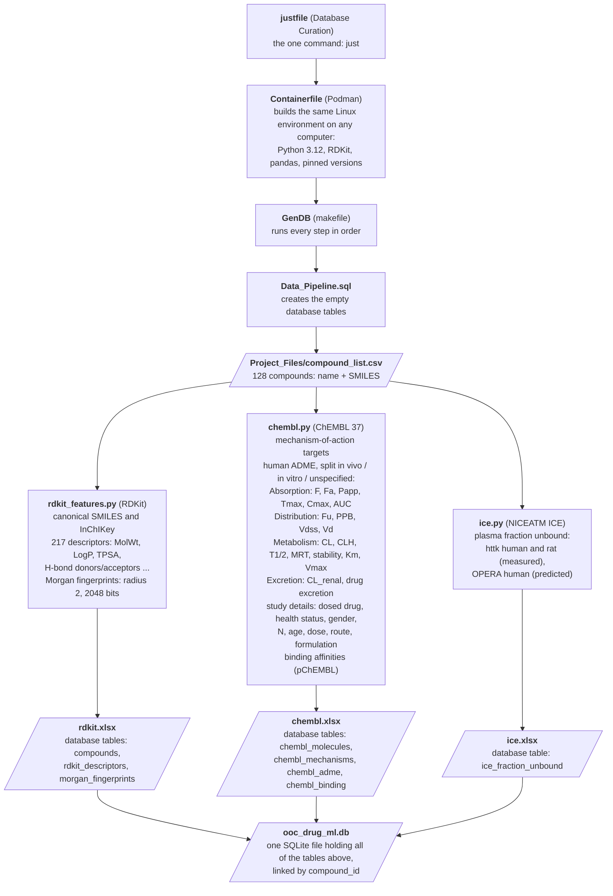

# Bioanalysis-OoC-rIVIVE-ML

Database Curation: one command builds a database of physicochemical, ADME and protein-binding data for the
compounds in `Project_Files/compound_list.csv`, plus one spreadsheet per data source.

```
git clone https://github.com/zunigajw/Bioanalysis-OoC-rIVIVE-ML && cd Bioanalysis-OoC-rIVIVE-ML && just
```

Requires `git`, `podman` and `just` (see the course setup). Everything else runs inside the container.

## Pipeline flow



Rectangles are code; slanted boxes are data files (the input list and every output).

## What `just` creates in `output/` (not stored in the repository)

| File | What is in it |
|---|---|
| `ooc_drug_ml.db` | The database. Tables: `compounds`, `rdkit_descriptors`, `morgan_fingerprints`, `chembl_molecules`, `chembl_mechanisms`, `chembl_adme`, `chembl_binding`, `ice_fraction_unbound`, `sources`; columns are described in `Data_Pipeline.sql` |
| `rdkit.xlsx` | Compounds (SMILES, InChIKey), the 217 RDKit descriptors, Morgan fingerprint bits |
| `chembl.xlsx` | ChEMBL match per compound; ADME summaries (in vivo, in vitro, unspecified); one sheet per ADME parameter and system with every human value, its units, reported error and study details; mechanism targets; binding |
| `ice.xlsx` | Plasma fraction unbound per compound (httk human and rat, OPERA predicted with applicability domain) |
